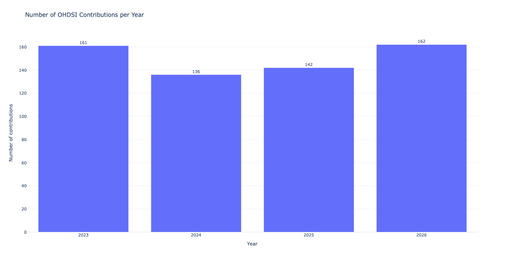
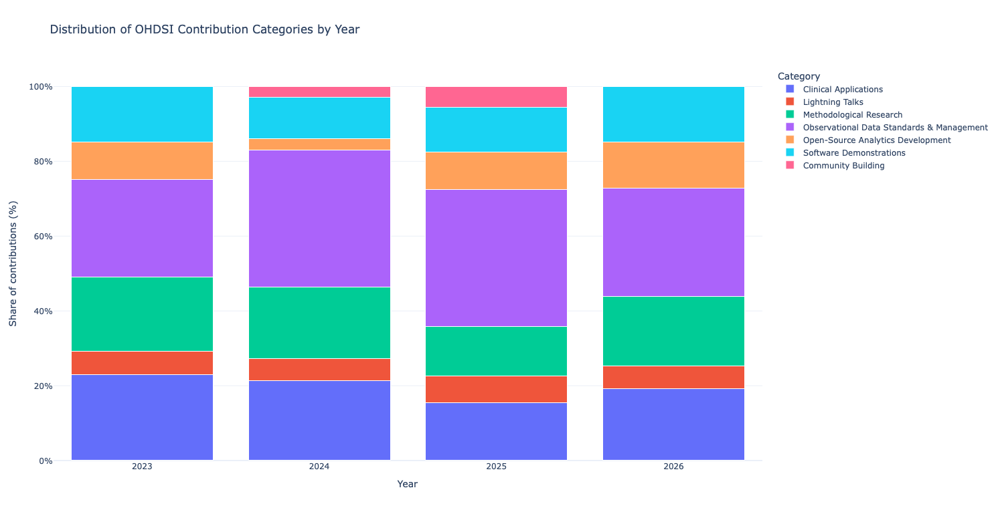
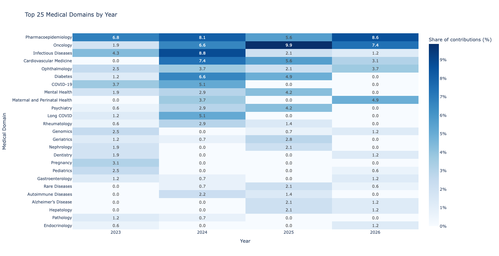
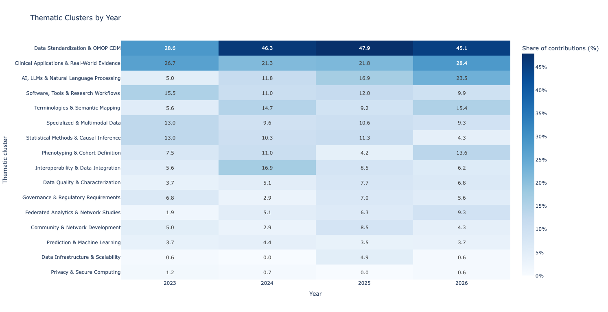

# OHDSI Global Symposium Trend Radar: Report on Emerging Topics and Community Trends

**Authors**

Katja Hoffmann¹, Ines Reinecke², Dagmar Waltemath³, Michèle Zoch¹

**Affiliations**

¹ Institute for Medical Informatics and Biometry, Faculty of Medicine Carl Gustav Carus, Technische Universität Dresden, Dresden, Germany

² Medizinische Universität Lausitz – Carl Thiem (MUL-CT), Cottbus, Germany

³ Institute of Community Medicine, Department of Medical Informatics, University Medicine Greifswald, Greifswald, Germany

**Reporting period:** 2023–2026

**Version:** 1.0, October 2026

**Corresponding author:** Katja Hoffmann, TU Dresden

**About this report**

This report presents an exploratory Trend Radar of contributions to the OHDSI Global Symposium and Collaborator Showcase from 2023 to 2026. It provides a structured overview of contribution categories, medical domains and technical and methodological themes represented within the OHDSI community. The analysis aims to identify patterns and candidate trends for further investigation and discussion; it does not constitute a definitive assessment or prediction of future developments.

## 1. Background

The purpose of this project is to develop a **Trend Radar report on the OHDSI Global Symposium**, providing a structured overview of emerging topics, methodological developments and areas of interest within the OHDSI community.

Based on contributions to the **OHDSI Global Symposium and Collaborator Showcase from 2023 to 2026**, the analysis explores how represented topics and medical domains are distributed and how they change over time. It combines descriptive analyses of medical domains and official contribution categories with an exploratory classification of technical and methodological themes.

The Trend Radar aims to identify potential developments that merit further attention and discussion within the OHDSI community. It provides an evidence-informed snapshot of community activities rather than a definitive assessment or prediction of research trends. Candidate trends are therefore treated as hypotheses that require further review of the underlying contributions, particularly where thematic classifications remain preliminary.

## 2. Methods

### 2.1 Data sources

The evidence list was compiled from publicly available OHDSI materials, including contributions to the OHDSI Global Symposium and the Collaborator Showcase. Contributions from 2023 to 2026 were consolidated into the master dataset, `ohdsi_evidence_master.xlsx`, which served as the basis for the subsequent analysis.

The dataset contains contribution-level information, including the year, title, official contribution category, assigned medical domain and thematic cluster, where applicable. Each entry retains its source information to support traceability to the original contribution.

### 2.2 Data collection, classification and preparation

The analysis covers contributions from 2023, 2024, 2025 and 2026. The following dimensions were considered:

- **Year**: year of the contribution or event.
- **Category**: official contribution category, as provided by the source.
- **Medical Domain**: medical or clinical domain addressed by the contribution.
- **Thematic Cluster**: technical or methodological topic addressed by the contribution.

Medical domains and thematic clusters were assigned based on contribution titles by a researcher with expertise in medical informatics. A second researcher with expertise in the same field independently reviewed the assignments. Discrepancies were discussed between the two researchers, and the classifications were subsequently revised where necessary to reach a consensus.

This review process was intended to improve the consistency and plausibility of the classifications. However, because the initial assignments were based on contribution titles, the classification may not fully reflect the content of the underlying work where titles provide limited information. The thematic clusters should therefore be regarded as an exploratory classification that may require further refinement.

### 2.3 Descriptive analysis

The Python analysis uses `pandas` for data preparation and aggregation and `plotly` for interactive visualizations.

The analysis includes:

- Annual contribution counts.
- The distribution of official categories by year.
- The distribution of medical domains across years.
- The distribution of technical thematic clusters across years.

For the medical-domain analysis, entries containing multiple semicolon-separated domains are split into individual labels. Empty entries and the label `Not specified` are excluded from medical-domain frequency counts and the medical-domain heatmap.

The medical-domain heatmap expresses the number of contributions assigned to each domain as a percentage of all contributions in the respective year. Since a contribution can be assigned to multiple medical domains, percentages across domains do not necessarily sum to 100%.

The technical thematic clusters are treated as an exploratory classification. TODO: **Their current assignments require further review before they can support robust conclusions about emerging trends.**

## 3. Results

### 3.1 Overall contribution volume

**Figure 1. Number of contributions per year**



The annual contribution counts show the size of the collected evidence base in each year. They provide important context for the other visualizations because changes in absolute counts can partly reflect differences in the total number of contributions.

The current dataset contains 601 contributions across the four years: 161 in 2023, 136 in 2024, 152 in 2025 and 162 in 2026.

### 3.2 Official contribution categories

**Figure 2. Distribution of official contribution categories by year**



This 100% stacked bar chart shows the relative distribution of official contribution categories in each year.


### 3.3 Medical domains: distribution across years

**Figure 3. Medical-domain heatmap**



The heatmap shows the distribution of the most frequently assigned medical domains across 2023–2026. Each cell represents the percentage of contributions in a given year associated with the respective domain.

The visualization helps identify which medical domains are represented in the collected OHDSI contributions and whether their relative representation changes over time.

<!-- An important observation is the comparatively large number of contributions in 2026 without a specific medical-domain assignment. In the current dataset, `Not specified` accounts for 64 of 162 contributions in 2026 (39.5%). For comparison, the corresponding proportions are 11 of 42 (26.2%) in 2023, 27 of 50 (54.0%) in 2024, and 25 of 52 (48.1%) in 2025. -->


### 3.4 Technical thematic clusters: distribution across years

**Figure 4. Technical thematic clusters by year**



The thematic-cluster heatmap shows the number of contributions assigned to each of the most frequent technical or thematic clusters across the four years.

Unlike the medical-domain heatmap, which focuses on clinical or medical subject areas, this analysis aims to capture the **technical and methodological interests of the OHDSI community**. The current visualization provides an initial overview of the distribution of assigned clusters. 

<!-- 

## 4. Discussion

### 4.1 Main observations

The exploratory analysis provides an initial overview of the topics represented in the OHDSI community between 2023 and 2026.

Three observations are particularly relevant for developing the Trend Radar:

1. **Medical domains are not consistently specified.** A substantial proportion of contributions lack a specific medical-domain assignment, including 39.5% of the 2026 records.
2. **Technical topics may cut across medical domains.** Contributions without a specific medical-domain assignment could concern reusable methods or infrastructure rather than one clinical field. The available results do not yet establish which topics explain this pattern.
3. **The technical classification is not yet mature enough for trend claims.** The thematic clusters require further review before changes in their frequency can be interpreted reliably.

### 4.2 Implications for the Trend Radar

The purpose of a Trend Radar is not simply to rank the most frequent labels. It is to identify developments that may be relevant to the OHDSI community and to provide a transparent rationale for further discussion.

The medical-domain analysis helps describe the clinical breadth of the contributions. The technical-cluster analysis should help explain what the community is working on across those domains.

Combining these perspectives is essential. For example, a growing cross-domain technical topic might not appear as a dominant medical domain, but could still be important for the future of observational research and OHDSI tooling.

Any proposed trend should therefore be checked against the underlying contributions and assessed for consistency across years, relevance to the community and strength of supporting evidence.

### 4.3 Limitations

The current analysis has several limitations:

- The dataset is based on publicly available contributions and may not represent all OHDSI activities.
- Differences in source coverage and collection procedures may affect comparisons between years.
- Missing medical-domain assignments limit the interpretation of clinical-domain distributions.
- Medical-domain labels may overlap or use different levels of granularity.
- Technical thematic clusters are preliminary and may contain inconsistent or overly broad assignments.
- Frequency and percentage plots are descriptive; they do not establish causality, scientific impact or the emergence of a trend.

These limitations should be addressed before the results are used to make strong claims about the direction of the OHDSI community.

## 5. Conclusion

The evidence list provides a transparent baseline for an exploratory Trend Radar based on OHDSI Global Symposium and Collaborator Showcase contributions from 2023–2026.

The medical-domain analysis is sufficiently developed to describe the current distribution of medical-domain labels, with the important caveat that `Not specified` is excluded from the domain visualizations.

The next priority is to refine the technical thematic clusters and compare them with the underlying contributions. This will help determine whether the high proportion of contributions without a specific medical-domain assignment in 2026 reflects cross-cutting developments, including—but not limited to—LLMs, phenotyping or reusable analytical methods.

The Trend Radar should be treated as a structured, evidence-informed interpretation of community activity rather than a definitive forecast.

## 6. TODO

- [ ] **Review the technical thematic clusters.** Check the assignments against titles, abstracts and descriptions; harmonize similar labels and improve consistency.
- [ ] **Investigate the 2026 `Not specified` medical-domain records.** Review their content to identify whether they share technical or methodological characteristics.
- [ ] **Validate candidate trends.** Examine whether potential topics such as LLMs, phenotyping, reusable analytics or infrastructure are supported by the underlying contributions and their distribution over time.
- [ ] **Review medical-domain labels for harmonization.** Identify synonymous, overlapping or differently granular labels where this would improve interpretability.
- [ ] **Check year-to-year comparability.** Document the source coverage and collection status for each year.
- [ ] **Develop the Trend Radar interpretation.** Derive a small number of evidence-supported observations and document the rationale for each.
- [ ] **Update the figures and README** after the thematic-cluster review.


## 7. Repository contents

| File | Purpose |
|---|---|
| `collect_ohdsi_evidence.py` | Collects the source evidence, if included in the repository. |
| `ohdsi_evidence_master.xlsx` | Master dataset used for the analysis. |
| `ohdsi_themenentwicklung.py` | Python script for descriptive analysis and visualization. |
| `plots/01_contributions_per_year.*` | Annual contribution counts. |
| `plots/02_category_distribution.*` | Official category distribution by year. |
| `plots/03_themencluster_by_year.*` | Technical thematic-cluster heatmap. |
| `plots/04_medical_domains_top15.*` | Most frequent medical-domain labels. |
| `plots/05_medical_domains_by_year.*` | Medical-domain heatmap by year. |
| `plots/medical_domain_counts.csv` | Overall medical-domain mention counts. |
| `plots/medical_domain_counts_by_year.csv` | Medical-domain mention counts by year. |
| `plots/medical_domain_percentage_by_year.csv` | Medical-domain percentages by year. |

The `.*` suffix represents the available export formats, such as HTML, PNG, SVG and PDF.

-->
## Installation and execution

Create and activate a virtual environment:

```bash
python -m venv .venv
source .venv/bin/activate
```

On Windows, activate it with:

```powershell
.venv\Scripts\activate
```

Install the required dependencies from requirements.txt:

```bash
pip install -r requirements.txt
```

Run the analysis:

```bash
python descriptive-stats.py
```

The script reads `ohdsi_evidence_master.xlsx` from the current working directory and writes the figures and CSV summaries to the `plots/` directory.

Static image exports may depend on the installed Plotly and Kaleido versions. HTML exports are also generated for interactive inspection.

The script generates interactive HTML visualizations and attempts to export static figures in PNG, SVG and PDF formats. Static exports depend on compatible versions of Plotly and Kaleido.