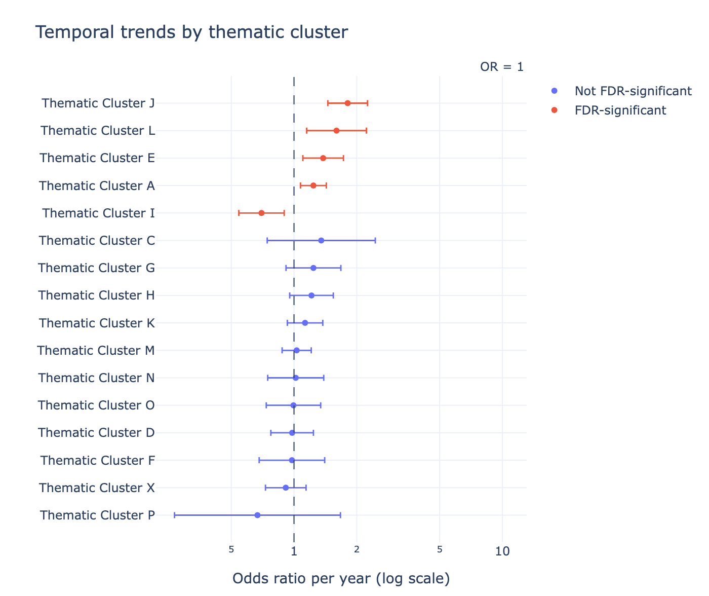
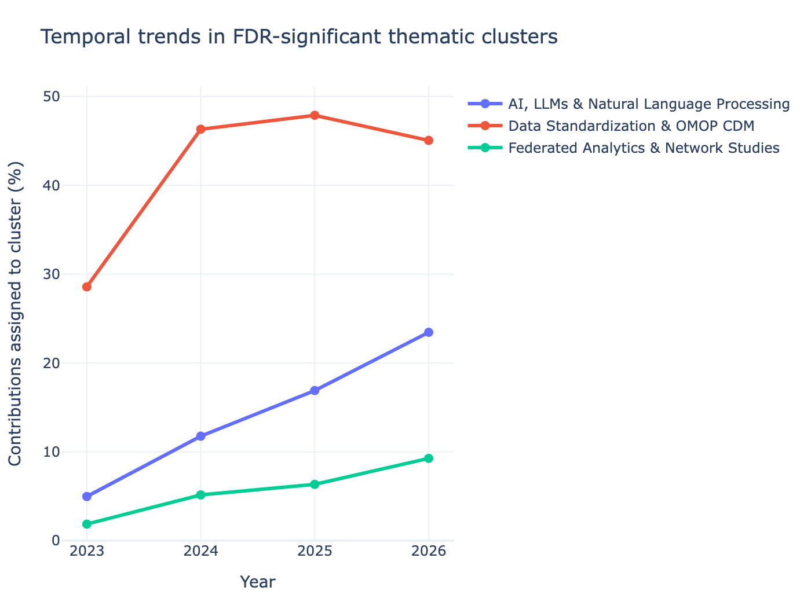
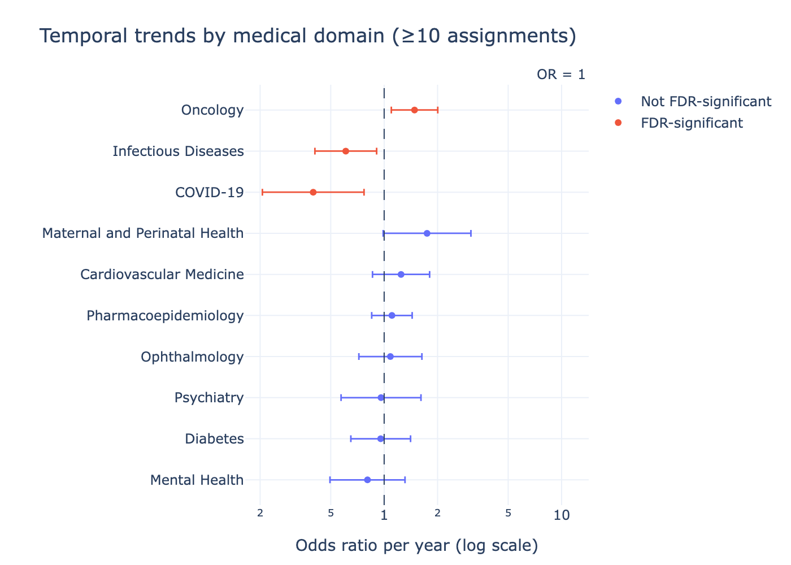
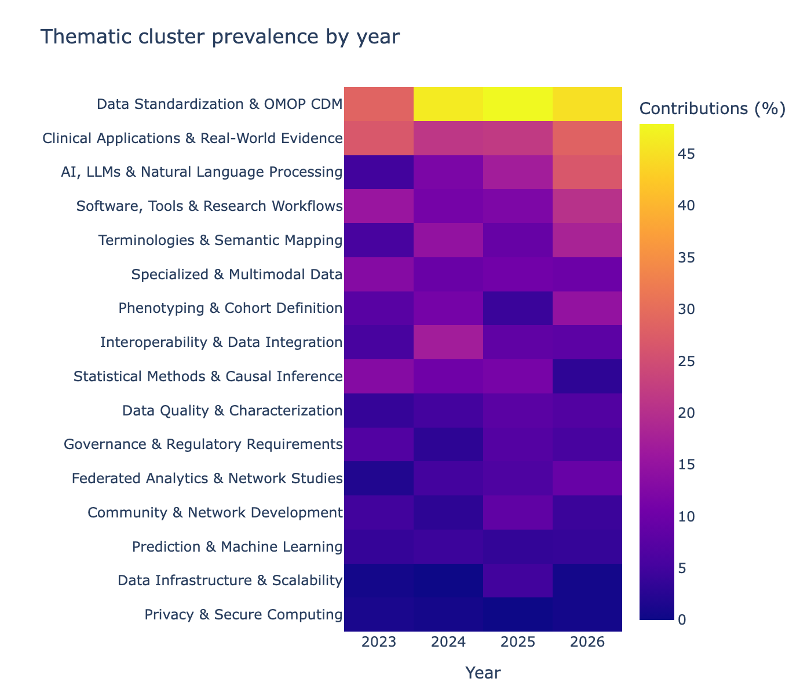
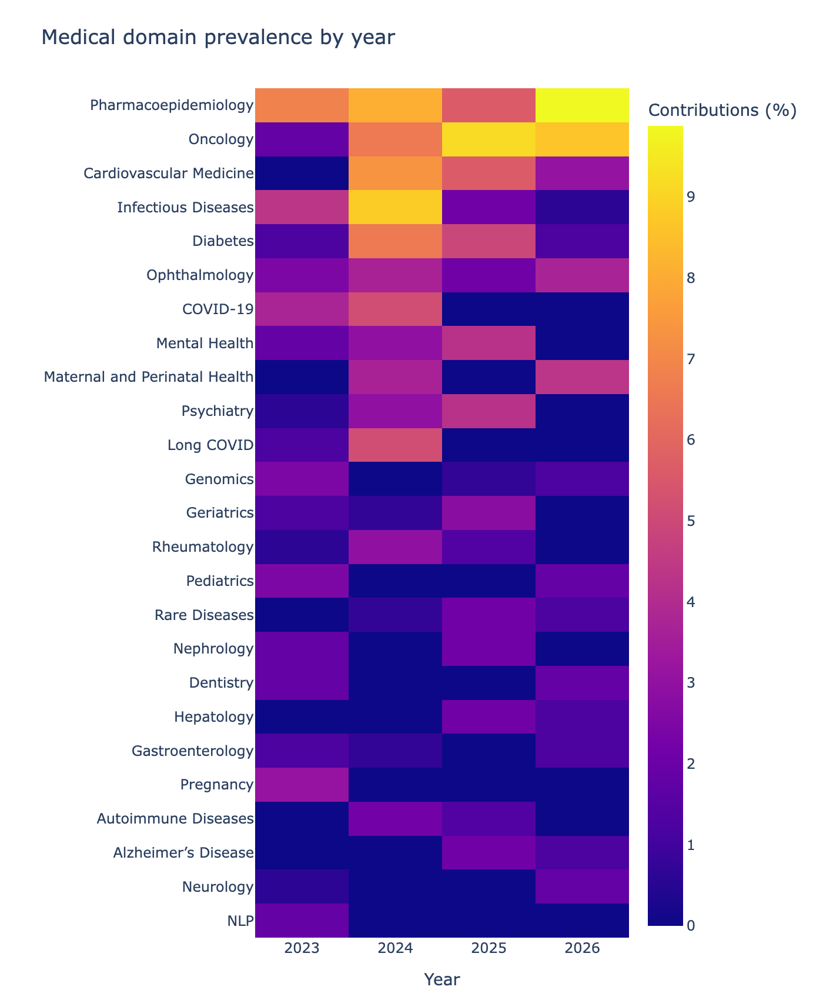

# OHDSI Global Symposium Trend Radar (2023–2026)

This repository accompanies the manuscript submitted to the *EFMI Medical Informatics Europe (MIE) Conference 2027*:

**A Trend Radar for the OHDSI Community: A Methodological Framework**

The paper presents a methodological framework for systematically exploring thematic developments in the OHDSI community based on contributions to the Global Symposium Collaborator Showcase.

The dataset comprises **601 contributions from 2023 to 2026**. The framework combines AI-assisted thematic clustering and classification with expert review, descriptive analysis, statistical trend analysis, and visualization.

## Data sources

The contribution list was compiled from publicly available OHDSI programmes:

- [2023 OHDSI Collaborator Showcase](https://www.ohdsi.org/2023-collaborator-showcase/)
- [2024 OHDSI Collaborator Showcase](https://www.ohdsi.org/2024-collaborator-showcase/)
- [2025 OHDSI Global Collaborator Showcase](https://www.ohdsi.org/2025-global-collaborator-showcase/)
- [2026 OHDSI Global Symposium Programme](https://docs.google.com/spreadsheets/d/e/2PACX-1vQMCFQXYHkPrbVrLojEo5NRQnHAUz6C9sfQ_DtvdKjXvJJW4l-A-N7yI3Y6e7WyWeB-KUEpnWl61-a6/pubhtml)

| Year | Contributions |
|---|---:|
| 2023 | 161 |
| 2024 | 136 |
| 2025 | 142 |
| 2026 | 162 |
| **Total** | **601** |

## Analysis and visualizations

The repository contains the evidence list, Python scripts for data processing and analysis, and example visualizations illustrating the proposed framework.

**Note:** This methodological release uses placeholder labels for thematic clusters and medical domains. The figures below demonstrate the visualization approach only; they do not present the actual classifications.

### Illustrative thematic trends

### Illustrative medical-domain trends

## Repository contents

- `ohdsi_evidence_master.xlsx` – contribution metadata and example data
- `scripts/` – Python scripts for data collection, descriptive statistics, trend analysis, and visualization
- `statistical_results/` – example statistical outputs and plots

## Related publication

*A Trend Radar for the OHDSI Community: A Methodological Framework.*  
Submitted to the *EFMI Medical Informatics Europe (MIE) Conference 2027*.

## Funding

NUM^OHDSI Connect, funded by the German Federal Ministry of Research, Technology and Space (BMFTR), grant number **01DM26001**.